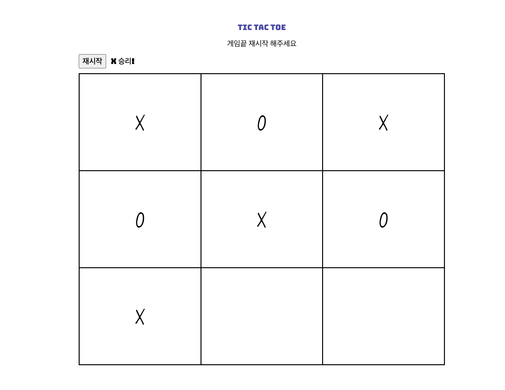
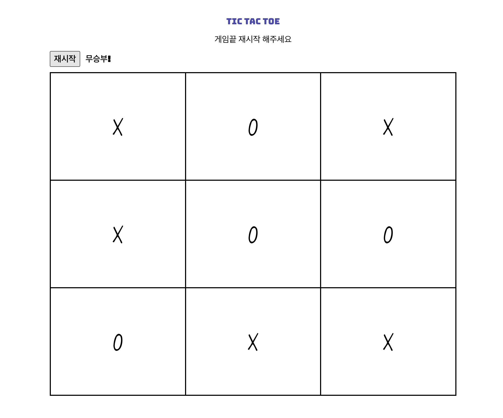

# Tic Tac Toe (틱택토)

바닐라 자바스크립트로 만든 2인용 틱택토 게임입니다. 두 플레이어가 같은 화면에서 번갈아 칸을 클릭해 X와 O를 놓고, 가로·세로·대각선으로 세 칸을 연결하면 승리합니다.

이 프로젝트는 **팩토리 함수와 모듈 패턴을 활용한 상태 관리**에 초점을 맞췄습니다. 콘솔에서 게임을 먼저 구현한 뒤, DOM과 클릭 이벤트를 연결해 브라우저에서 플레이할 수 있도록 확장했습니다.

[The Odin Project](https://www.theodinproject.com/) 커리큘럼의 일부입니다.

---

## 데모 (Live Demo)

[사이트 바로 가기](https://jhoncarmack.github.io/Tic_Tac_Toe/)

## 스크린샷

<p align="center">
  
  
</p>

---

## 주요 기능

- 3×3 게임판의 칸을 클릭해 X / O 마커 배치
- 두 플레이어가 순서를 번갈아 가며 착수
- 이미 마커가 놓인 칸의 중복 착수 방지
- 가로·세로·대각선 승리 조건과 무승부 판정
- 착수, 중복 착수, 게임 종료 안내를 화면에 표시
- 게임 종료 후 추가 착수 차단
- 재시작 버튼으로 게임판과 진행 상태를 초기화해 새 게임 시작

## 사용 기술

- HTML5
- CSS3
- JavaScript (ES6+)

---

## 시작하기

저장소를 클론한 뒤 프로젝트의 HTML 파일을 브라우저에서 열어 실행할 수 있습니다.

```bash
git clone https://github.com/Jhoncarmack/Tic_Tac_Toe.git
cd Tic_Tac_Toe
```

---

## 설계 개요

게임판 데이터는 `gameBoard` 모듈 안의 2차원 배열에 저장합니다. `createBoardGrid()`에서 만든 DOM 칸도 `grids`라는 2차원 배열에 보관해, 데이터와 화면의 칸을 같은 행·열 좌표로 다룰 수 있도록 했습니다.

### 구성과 역할

| 구성                                   | 역할                                                   |
| -------------------------------------- | ------------------------------------------------------ |
| `gameBoard`                            | 게임판 배열 보관과 초기 생성                           |
| `gameControl()`                        | 착수, 턴 교대, 착수 횟수, 착수 차단과 재시작 상태 관리 |
| `createElement()`, `createBoardGrid()` | 화면 요소와 3×3 칸 생성, DOM 참조 보관                 |
| `callGame()`                           | 칸 클릭을 착수 및 승리·무승부 확인과 연결              |
| `restartBoard()`                       | 기존 DOM 요소와 재시작 함수를 받아 버튼 이벤트 연결    |

### 게임 진행 흐름

- **착수**: 클릭한 좌표를 게임 함수에 전달하고, 게임이 진행 중이며 빈 칸일 때 마커를 놓고 화면과 턴 상태를 갱신합니다.
- **판정**: 착수 후 승리를 먼저 확인하고, 승리자가 없는 상태에서 게임판이 모두 채워졌다면 무승부로 처리합니다.
- **종료**: 게임이 끝나면 추가 착수를 막고 종료 안내를 표시합니다.
- **재시작**: 게임판과 화면의 마커를 지우고, 턴·착수 횟수·종료 상태를 초기화합니다.

---

## 배운 점

### 콘솔에서 게임을 완성한 뒤 화면으로 확장하기

가장 뜻깊었던 경험은 '집을 안에서부터 짓기' 방식으로 개발한 것입니다. 처음부터 화면을 만들기보다 게임판, 턴 교대, 승리와 무승부 판정 등 콘솔에서 동작하는 게임을 먼저 구현했습니다.

직접 함수를 호출하고 인수를 전달하며 동작을 확인한 뒤 DOM을 연결하니, 화면에서 어떤 기능을 호출해야 하는지 파악하기가 수월했습니다. 막막할 때는 구현할 수 있는 작은 기능부터 시작하고, 핵심 동작을 확인한 뒤에야 화면으로 확장하는 접근을 배웠습니다.

### 스코프와 클로저를 활용한 상태 관리

전역 변수와 전역 코드를 줄이기 위해 함수 내부에 상태를 두고, 외부에 필요한 기능을 반환하는 구조를 연습했습니다. 내부 상태를 반환한 함수를 통해 다루면서, 의도하지 않은 접근과 변경을 줄이는 캡슐화의 목적을 이해했습니다.

변수뿐 아니라 함수 이름에도 스코프가 적용된다는 점을 배웠습니다. 지역 변수를 이름만으로 어디서나 사용할 수는 없으며, 필요한 값이나 기능을 전달하는 방법을 생각해야 했습니다.

### 함수 반환과 인수 전달

`return { game }`은 `return { game: game }`의 축약 표현이며, 이때 프로퍼티에 담기는 것은 함수의 참조라는 점을 배웠습니다. 객체에서 해당 함수를 꺼내 이후에 호출할 수 있습니다.

또한 필요한 객체와 함수의 참조를 인수로 전달하는 방법을 익혔습니다. 재시작 버튼을 연결할 때 DOM 요소를 담은 객체와 재시작 함수를 전달하면서, 함수의 위치를 옮기는 것 외에도 필요한 값을 전달해 연결할 수 있다는 선택지를 얻었습니다.

### 함수 호출과 객체 참조의 차이

이 프로젝트에서 작성한 팩토리와 DOM 생성 함수는 호출할 때마다 새로운 객체나 요소를 만듭니다. 기존 결과를 다시 사용하려면 생성 함수를 반복해서 호출하기보다, 처음 반환받은 객체를 보관하고 재사용해야 했습니다.

```js
const inGameControl = gameControl();
const grids = inGameControl.grids;
```

반환값은 즉시 사용하거나 보관할 수 있지만, 반환했다는 이유로 기존 변수와 객체의 프로퍼티가 자동으로 연결되지는 않습니다. 특히 불리언 값을 객체의 프로퍼티에 담으면 당시의 값이 저장되므로, 이후 원래 변수를 바꿔도 그 프로퍼티가 자동으로 갱신되지 않는다는 점을 배웠습니다.

변수명이 달라도 같은 객체를 참조할 수 있고, 이름이 같아도 별개의 상태를 다룰 수 있습니다. 이름뿐 아니라 실제로 어떤 값을 읽고 변경하는지 확인하는 것이 중요했습니다.

### 호출 사이에 유지할 상태의 위치

턴이나 게임 종료 여부처럼 다음 착수에서도 유지되어야 하는 상태를 착수 함수 안에 선언하면, 호출할 때마다 새 지역 변수가 만들어지고 초기화되었습니다.

이러한 상태를 컨트롤러의 스코프에 두고 내부 함수들이 클로저를 통해 함께 사용하도록 구성하면서, 변수의 위치와 상태가 유지되는 범위의 관계를 이해했습니다.

### DOM 요소의 참조를 배열에 보관하기

생성한 칸을 컨테이너에 추가하면서, 같은 DOM 요소의 참조를 2차원 배열에도 보관할 수 있다는 점을 배웠습니다.

배열과 DOM 요소는 별개의 객체지만, 배열의 각 원소를 통해 화면에 추가한 요소에 접근할 수 있습니다. 게임판과 같은 행·열 구조로 칸을 보관해, 해당 좌표의 화면을 갱신하고 클릭 이벤트를 연결했습니다.

### 함수의 책임과 실행 흐름

하나의 함수에 여러 책임이 섞이면 코드 흐름을 따라가기 어려웠습니다. 착수, 판정, 재시작, 화면 처리처럼 역할을 구분하고, 함수와 변수의 이름이 실제 역할을 드러내도록 고민했습니다. 서로 다른 스코프에서 같은 역할을 하는 값에는 일관된 이름을 사용할 수 있다는 점도 배웠습니다.

문제가 생겼을 때는 새 변수나 조건을 추가하기 전에 기존 실행 순서와 `return` 위치를 먼저 확인했습니다. 게임 종료 후의 중복 안내 문제를 해결하며, 조건을 검사하는 순서도 동작을 결정한다는 점을 경험했습니다.

---

## AI 활용 범위

- 함수명과 변수명이 역할을 잘 드러내는지 피드백을 받고, 제안된 이름을 검토해 사용했습니다.
- 막힌 부분은 먼저 원인을 추측하고 직접 구현해 본 뒤, 코드에 대한 제 사고 과정을 AI에 설명했습니다. 완성 코드 대신 제 사고에대한 잘못된 추측과 다음 확인 지점에 대한 도움을 요청하고, 받은 의견을 직접 판단하고 실행하며 확인했습니다.
- 커밋 메시지를 검토받고, README의 구성과 학습 내용을 정리하는 데 도움을 받았습니다.

## 보완할 점과 확장 아이디어

이번 프로젝트에서는 JavaScript의 동작과 상태 관리에 집중해 화면 디자인은 기본적인 수준으로 구성했습니다. 이후에는 다음과 같은 개선을 해 보고 싶습니다.

- **화면 디자인 개선**: 폰트 외에도 배치, 색상, 마커와 게임판 디자인을 보완하기
- **꾸미기 기능**: 마커와 게임판 테마를 선택하거나 구매하는 기능 추가하기
- **착수 제한 시간**: 각 턴에 제한 시간을 두어 게임의 긴장감 높이기
- **온라인 플레이와 채팅**: 다른 사용자와 함께 플레이하며 대화할 수 있도록 확장하기

## 감사의 말

- 프로젝트 과제와 학습 방향을 제공한 [The Odin Project](https://www.theodinproject.com/)

## 만든 사람

**Jhoncarmack** — [GitHub](https://github.com/Jhoncarmack)
